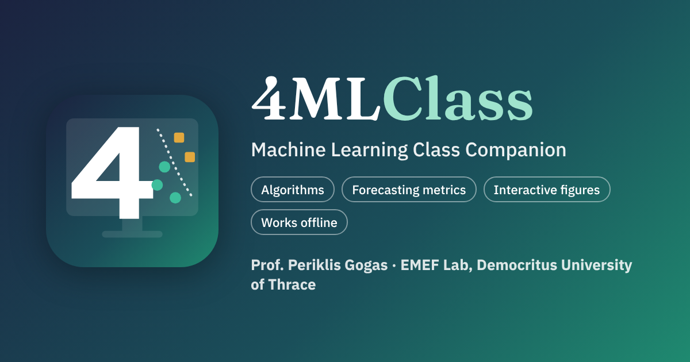

# 4MLClass: Machine Learning Class Companion

**The class companion for the machine learning lectures of Prof. Periklis Gogas**
(EMEF Lab, Department of Economics, Democritus University of Thrace).



Open the app: **https://perrygogas.github.io/4MLClass/**

4MLClass follows the lecture slides in the same order, step by step, with interactive versions of the
slide figures and a short multiple-choice check at the end of every chapter. Students use it on their
phones or laptops during the lecture; the lecturer can use it on the projector.

## Contents

| Presentation | Chapters | Interactive figures |
|---|---|---|
| 1. Machine Learning Algorithms (slides 28 to 200) | Classification or regression, types of ML, reinforcement learning, K-Means and hierarchical clustering, supervised learning, ANN, decision trees, random forests, XGBoost, SVM and the kernel trick, SVR, KNN, ensembles | K-Means step by step, dendrogram, ReLU neurons, activation functions, gradient descent, fruit decision tree with Gini, random forest vote, XGBoost, SVM margin, kernel trick, SVR band, KNN, ensembles |
| 2. Metrics to evaluate our forecasts (slides 1 to 50) | ML metrics, the confusion matrix, is accuracy that important?, the threshold and the cost function, ROC and AUC, regression metrics | Confusion matrix, threshold T with a logit, ROC curve and AUC, regression metrics |

## Features

- Slide order and slide wording; free navigation (chapter menu, Next / Back, arrow keys)
- Figures with PNG / SVG export and Data / Table (Excel)
- "Deep dive" links to the matching 4MLSim simulations and to 4Cast Lab
- QR code so students open the same page on their phones
- Projector mode, light and dark theme, "?" help on every control
- Installable app (PWA) that works offline; also a single-file offline version

## Install as an app

- **Chrome / Edge (computer or Android):** click **Install app** in the header, or the install icon in the address bar.
- **iPhone / iPad:** open the page in Safari, tap **Share**, then **Add to Home Screen**.

## Repository layout

```
index.html              the app (single page)
manifest.webmanifest    installable app
sw.js                   offline helper (generated by tools/build.py)
assets/css, assets/js   style and code (core.js, plot.js, core-ml.js, figures*.js, content-p*.js, app.js)
assets/vendor           Temml (math), SheetJS (Excel), qrcode-generator (QR code)
assets/fonts, img       self-hosted fonts, icon, EMEF logo
icons/                  app icons, social preview
tools/build.py          regenerates sw.js and the single-file offline version
```

After any change run `python3 tools/build.py`, then upload. The offline helper picks up the new version
automatically.

## License

MIT License (see `LICENSE`). Third-party components keep their own licenses (Temml MIT, SheetJS CE
Apache-2.0, qrcode-generator MIT, IBM Plex / Fraunces / STIX Two Math fonts SIL OFL).
Lecture content (c) 2026 Periklis Gogas.
